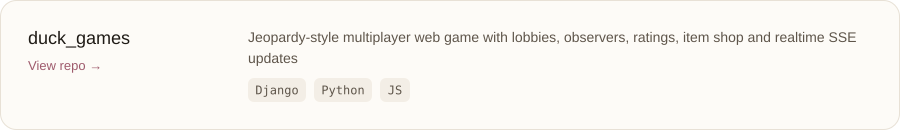
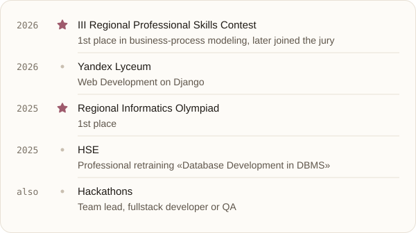

<picture>
  <source media="(prefers-color-scheme: dark)" srcset="assets/banner-dark.svg" />
  
</picture>

<table>
<tr>
<td width="140" align="center" valign="middle">

</td>
<td valign="middle">

I build client-server apps end to end — from the database schema and REST API to the desktop or mobile client — and then break them on purpose as a QA. I like systems where backend, data, UX and business process meet in one working product.

[denikolop@mail.ru](mailto:denikolop@mail.ru) · [Telegram @prettywi1d](https://t.me/prettywi1d)

</td>
</tr>
</table>

<picture>
  <source media="(prefers-color-scheme: dark)" srcset="assets/divider-dark.svg" />
  
</picture>

## About me

<table>
<tr><td width="140" valign="top">Now</td><td>QA / BA at Taskin (freelance exchange, task-in.ru) Intern at Beeline — AI agent for the B2B department</td></tr>
<tr><td valign="top">Studying</td><td>Perm Aviation College, Information Systems & Programming, 4th year</td></tr>
<tr><td valign="top">Based in</td><td>Moscow / Perm, RU</td></tr>
<tr><td valign="top">Languages</td><td>Russian (native), English (C1), Turkish (B2)</td></tr>
</table>

## Skills & tools

<picture>
  <source media="(prefers-color-scheme: dark)" srcset="assets/skills-dark.svg" />
  
</picture>

## Featured projects

<a href="https://github.com/prettyw1ld/Desktop-Helper"><picture>
  <source media="(prefers-color-scheme: dark)" srcset="assets/project-desktop-helper-dark.svg" />
  
</picture></a>

<a href="https://github.com/prettyw1ld/DamircoApp"><picture>
  <source media="(prefers-color-scheme: dark)" srcset="assets/project-damirco-dark.svg" />
  
</picture></a>

<a href="https://github.com/prettyw1ld/html-editor"><picture>
  <source media="(prefers-color-scheme: dark)" srcset="assets/project-html-editor-dark.svg" />
  
</picture></a>

<a href="https://github.com/prettyw1ld/duck_games"><picture>
  <source media="(prefers-color-scheme: dark)" srcset="assets/project-duck-games-dark.svg" />
  
</picture></a>

Cards are clickable · DamircoApp backend lives in <a href="https://github.com/prettyw1ld/DamircoAPI">DamircoAPI</a>

## Achievements

<table>
<tr>
<td width="68%" valign="top">
<picture>
  <source media="(prefers-color-scheme: dark)" srcset="assets/achievements-dark.svg" />
  
</picture>
</td>
<td width="32%" align="center" valign="middle">

</td>
</tr>
</table>

<picture>
  <source media="(prefers-color-scheme: dark)" srcset="assets/divider-dark.svg" />
  
</picture>

<picture>
  <source media="(prefers-color-scheme: dark)" srcset="https://streak-stats.demolab.com?user=prettyw1ld&border_radius=16&background=11141C&border=252A37&ring=E0A7B6&fire=E0A7B6&currStreakNum=EEF0F5&sideNums=EEF0F5&currStreakLabel=E0A7B6&sideLabels=A3A9B8&dates=7A8296&stroke=252A37&date_format=j%20M%5B%20Y%5D" />
  
</picture>

  

[denikolop@mail.ru](mailto:denikolop@mail.ru) · [Telegram @prettywi1d](https://t.me/prettywi1d)

Thanks for stopping by

