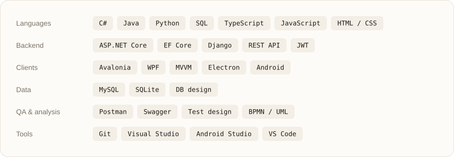
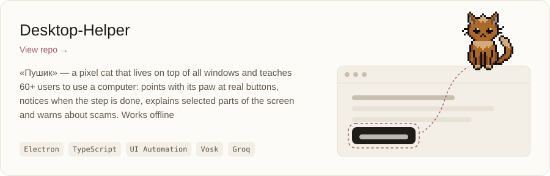
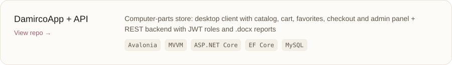
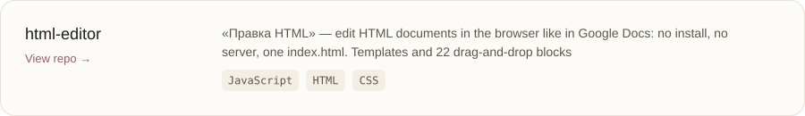

<picture>
  <source media="(prefers-color-scheme: dark)" srcset="assets/banner-dark.svg" />
  
</picture>

<table>
<tr>
<td width="140" align="center" valign="middle">

</td>
<td valign="middle">

I build client-server apps end to end — from the database schema and REST API to the desktop or mobile client — and then break them on purpose as a QA. I like systems where backend, data, UX and business process meet in one working product.

[denikolop@mail.ru](mailto:denikolop@mail.ru) · [Telegram @prettywi1d](https://t.me/prettywi1d)

</td>
</tr>
</table>

<picture>
  <source media="(prefers-color-scheme: dark)" srcset="assets/divider-dark.svg" />
  
</picture>

## About me

<table>
<tr>
<td width="62%" valign="top">

**Now**
- QA / BA at Taskin (freelance exchange, task-in.ru)
- Intern at Beeline — AI agent for the B2B department

**Studying** 
Perm Aviation College, Information Systems & Programming, 4th year

**Based in** 
Moscow / Perm, RU

**Languages** 
Russian (native), English (C1), Turkish (B2)

</td>
<td width="38%" align="center" valign="middle">

me, after “just one small fix”

</td>
</tr>
</table>

## Skills & tools

<picture>
  <source media="(prefers-color-scheme: dark)" srcset="assets/skills-dark.svg" />
  
</picture>

## Featured projects

<table>
<tr>
<td width="50%">
<a href="https://github.com/prettyw1ld/Desktop-Helper"><picture>
  <source media="(prefers-color-scheme: dark)" srcset="assets/project-desktop-helper-dark.svg" />
  
</picture></a>
</td>
<td width="50%">
<a href="https://github.com/prettyw1ld/DamircoApp"><picture>
  <source media="(prefers-color-scheme: dark)" srcset="assets/project-damirco-dark.svg" />
  
</picture></a>
</td>
</tr>
<tr>
<td width="50%">
<a href="https://github.com/prettyw1ld/html-editor"><picture>
  <source media="(prefers-color-scheme: dark)" srcset="assets/project-html-editor-dark.svg" />
  
</picture></a>
</td>
<td width="50%">
<a href="https://github.com/prettyw1ld/duck_games"><picture>
  <source media="(prefers-color-scheme: dark)" srcset="assets/project-duck-games-dark.svg" />
  
</picture></a>
</td>
</tr>
</table>

Cards are clickable · DamircoApp backend lives in <a href="https://github.com/prettyw1ld/DamircoAPI">DamircoAPI</a>

## Achievements

<table>
<tr>
<td width="68%" valign="top">

- **1st place** — III Regional Professional Skills Contest, business-process modeling (2026), later joined the jury
- **1st place** — Regional Informatics Olympiad (2025)
- **HSE** — professional retraining «Database Development in DBMS» (2025)
- **Yandex Lyceum** — «Web Development on Django» (2026)
- Hackathons as team lead / fullstack / QA

</td>
<td width="32%" align="center" valign="middle">

</td>
</tr>
</table>

<picture>
  <source media="(prefers-color-scheme: dark)" srcset="assets/divider-dark.svg" />
  
</picture>

<picture>
  <source media="(prefers-color-scheme: dark)" srcset="https://streak-stats.demolab.com?user=prettyw1ld&border_radius=16&background=16181D&border=2A2D34&ring=D8A1B0&fire=D8A1B0&currStreakNum=ECE7E1&sideNums=ECE7E1&currStreakLabel=D8A1B0&sideLabels=A9A29A&dates=948D84&stroke=2A2D34&date_format=j%20M%5B%20Y%5D" />
  
</picture>

  

[denikolop@mail.ru](mailto:denikolop@mail.ru) · [Telegram @prettywi1d](https://t.me/prettywi1d)

Thanks for stopping by

