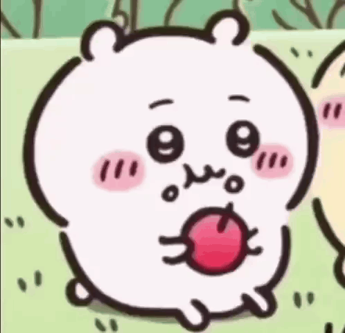
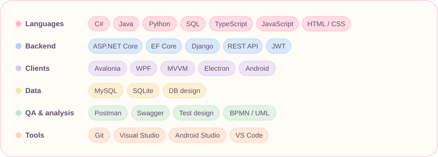
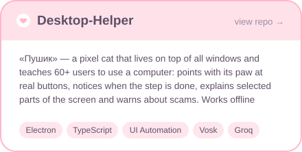
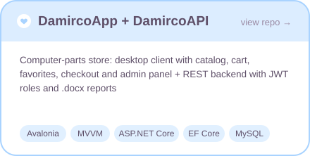
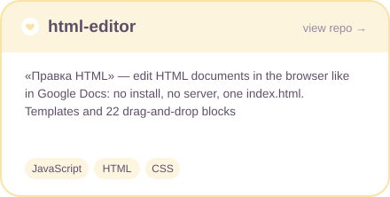
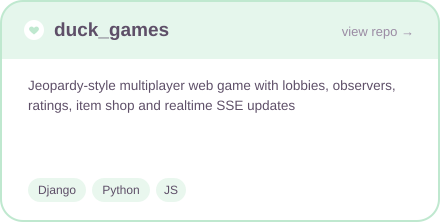

<a href="mailto:denikolop@mail.ru">denikolop@mail.ru</a> &nbsp;·&nbsp; <a href="https://t.me/prettywi1d">Telegram @prettywi1d</a> &nbsp;·&nbsp; Moscow / Perm, RU

## About me

<table>
<tr>
<td width="62%" valign="top">

I build client-server apps end to end — from the database schema and REST API to the desktop or mobile client — and then break them on purpose as a QA. I like systems where backend, data, UX and business process meet in one working product.

**Now**
- QA / BA at Taskin (freelance exchange, task-in.ru)
- Intern at Beeline — AI agent for the B2B department

**Studying** · Perm Aviation College, Information Systems & Programming, 4th year 
**Languages** · Russian (native), English (C1), Turkish (B2)

</td>
<td width="38%" align="center" valign="middle">

<i>me, after “just one small fix”</i>

</td>
</tr>
</table>

## Skills & tools

## Featured projects

<table>
<tr>
<td width="50%">

</td>
<td width="50%">

</td>
</tr>
<tr>
<td width="50%">

</td>
<td width="50%">

</td>
</tr>
</table>

Cards are clickable · DamircoApp backend lives in <a href="https://github.com/prettyw1ld/DamircoAPI">DamircoAPI</a>

## Achievements

<table>
<tr>
<td width="68%" valign="top">

- **1st place** — III Regional Professional Skills Contest, business-process modeling (2026), later joined the jury
- **1st place** — Regional Informatics Olympiad (2025)
- **HSE** — professional retraining «Database Development in DBMS» (2025)
- **Yandex Lyceum** — «Web Development on Django» (2026)
- Hackathons as team lead / fullstack / QA

</td>
<td width="32%" align="center" valign="middle">

</td>
</tr>
</table>

  

**Let's talk:** [denikolop@mail.ru](mailto:denikolop@mail.ru) · [Telegram @prettywi1d](https://t.me/prettywi1d)

thanks for stopping by ♡

